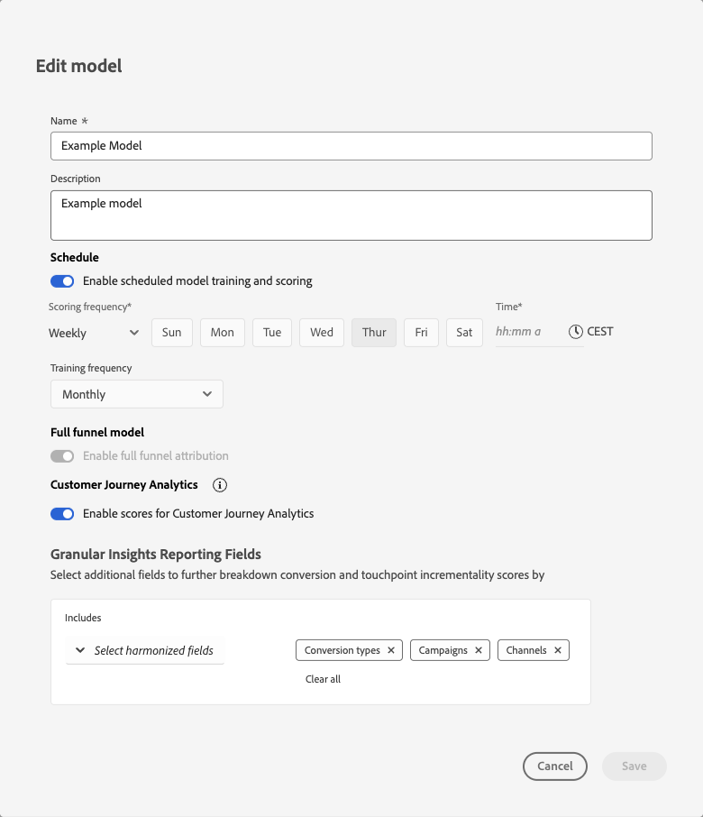

# 모델 개요

{{mm-mca-rebranding}}

Marketing Campaign Analytics의 모델 기능을 사용하면 비즈니스 목표에 맞는 모델을 구성하고, 교육하고, 평가할 수 있습니다. 교육 및 점수는 멀티터치 기여도 분석과 마케팅 믹스 모델링 간의 AI 기반 전환 학습을 지원합니다.

이 모델은 애플리케이션 워크플로의 일부로 만드는 통합 데이터를 기반으로 합니다.

Marketing Campaign Analytics의 모델은 마케팅 투자를 기반으로 지정된 결과를 측정하고 예측하기 위해 사용되는 머신 러닝 모델입니다. 마케팅 접점 및 요약 수준 데이터를 입력으로 사용할 수 있습니다. Marketing Campaign Analytics을 사용하면 매출, 판매 수량, 리드 등과 같은 다양한 변수, 차원 및 결과 세트를 기반으로 모델의 변형을 만들 수 있습니다.

모델은 다음을 필요로 합니다.

* 전환 1개.
* 요약 수준 데이터, 마케팅 접점 데이터(이벤트 데이터) 또는 둘 다로 구성된 하나 이상의 마케팅 접점(채널).
* 구성 가능한 전환 확인 기간.
* 구성 가능한 교육 창.

모델은 다음을 선택적으로 포함할 수 있습니다.

* 외부 요인.
* 내부 요인.
* 과거 관련자 경험, 증분 테스트, 기타 모델 등 다른 소스의 마케팅 기여에 대한 사전 지식.
* 마케팅 데이터가 희소할 때 상대 지출 공유를 프록시로 사용하는 지출 공유.

모형을 처음 만들었을 때, 그 만들기는 곧바로 훈련과 채점 과정을 시작한다. 초기 교육 및 채점 실행이 완료되면 모델 인사이트를 검토할 수 있습니다. 모델은 나중에 다시 교육됩니다. 또한 모델에 데이터를 추가할 때 모델에 대한 수동 복원이 필요합니다. 재교육 및 재검사는 새로운 발견과 정보가 나타나고 비즈니스 목표에 가장 적합한 모델 적합성을 얻기 위해 조정이 필요하므로 반복적인 프로세스입니다.

## 전체 funnel 모델링

{{release-limited-testing-section}}

전체 funnel 모델링을 사용하면 funnel의 실제 단계를 모델링할 수 있습니다. 예를 들어 뉴스레터 등록에서 구매까지. 전체 funnel 모델링은 마케팅이 해당 funnel을 통해 고객을 이동하는 방법을 보여줍니다. 전체 funnel 모델링을 통해 상위 funnel 채널에 다운스트림에 영향을 주는 전환에 대한 크레딧을 제공할 수 있으며, 두 번 카운트하지 않고 기여도가 올바르게 합산되도록 결과를 조정합니다.

전체 funnel 모델링을 사용하여 하나의 상위 funnel KPI와 하나의 하위 funnel KPI를 모델링할 수 있습니다.

* 상위 funnel KPI의 예로는 뉴스레터 등록 및 기타 브랜드 인지도 지표가 있습니다.
* 낮은 funnel 지표의 예로는 매출 및 주문과 같은 일반적인 전환 지표가 있습니다.

상위 funnel 전술은 전환 집중 MMM 모델에서 더 적은 크레딧을 받습니다. 전체 funnel 모델링을 통해 다음을 이해할 수 있습니다.

* 미디어 및 마케팅 전략이 funnel 상위 목표에 기여한 사항
* 어떤 미디어 및 마케팅 전략이 전환 목표에 간접 영향을 미쳤습니다. 상위 funnel 모델 가중치는 적절한 미디어 및 마케팅 전략에 더 높은 가중치를 부여하기 위해 하위 funnel 모델에 대한 입력입니다.

## 모델 구축

모델을 만들려면 **[!UICONTROL Open model canvas]**&#x200B;을(를) 선택할 때 사용할 수 있는 Marketing Campaign Analytics 단계별 안내식 모델 구성 흐름을 사용하십시오. 자세한 내용은 [모델 빌드](build.md)를 참조하십시오.

## 모델 관리

Marketing Campaign Analytics 인터페이스에서 현재 모델의 표를 보려면 다음을 수행하십시오.

1. 왼쪽 레일에서  **[!UICONTROL Models]** 선택

1. 현재 모델의 표가 표시됩니다.

   테이블 열은 모델에 대한 세부 사항을 지정합니다.

   | 열 이름 | 세부 사항 |
   |---|---|
   | **[!UICONTROL Name]** | 모델 이름. 모델이 전체 funnel 모델링에 대해 활성화되어 있으면 [!BADGE 전체 funnel]{type=Informative} 페이지가 표시됩니다. |
   | **[!UICONTROL Description]** | 모델에 대한 설명. |
   | **[!UICONTROL Conversion event]** | 모델에 대해 선택한 변환입니다. |
   | **[!UICONTROL Run frequency]** | 모델 교육의 실행 빈도입니다. |
   | **[!UICONTROL Last run]** | 모델의 마지막 교육 날짜 및 시간입니다. |
   | **[!UICONTROL Status]** | 모델의 상태입니다. |

   오름차순  또는 내림차순  순서로 열의 테이블을 정렬하려면 열의 제목을 선택합니다.

   **[!UICONTROL Name]** 열을 정렬하거나 크기를 조정하려면 **[!UICONTROL Name]** 를 선택합니다. 컨텍스트 메뉴에서 **[!UICONTROL Sort ascending]**, **[!UICONTROL Sort descending]** 또는 **[!UICONTROL Resize column]**&#x200B;을(를) 선택합니다. **[!UICONTROL Name]** 열의 크기를 조정하려면 열 구분 기호 위로 마우스를 가져갑니다.

   모델의 보고된 상태는 모델이 라이프사이클 내에 있는 위치에 따라 다릅니다. 예를 들어 모델이 생성되었는지, (재)트레이닝이 성공했는지 또는 (재)채점이 성공했는지 여부에 상관없이 표시됩니다.

   아래 표에서:

   *  - 모델 라이프사이클에서 단계가 성공적으로 실행되었음을 나타냅니다.
   *  - 모델 수명 주기에서 현재 진행 중인 단계 실행을 나타냅니다.
   *  - 모델 수명 주기에서 단계 실행이 실패했음을 나타냅니다.

   | 상태 | [빌드](/help/models/build.md) | [교육](/help/models/train-score.md#train) | [점수](/help/models/train-score.md#score) | [다시 교육](/help/models/train-score.md#train) | [다시 검색](/help/models/train-score.md#score) |
   |---|:---:|:---:|:---:|:---:|:---:|
   | 진행 중 |  | | | | |
   | 진행 중 |  |  | | | |
   | 진행 중 |  |  |  | | |
   | 진행 중 |  |  |  |  | |
   | 진행 중 |  |  |  |  |  |
   | 교육 실패 |  |  | | | |
   | 교육 실패 |  |  |  |  | |
   | 교육 성공 |  |  | | | |
   | 교육 성공 |  |  |  |  | |
   | 채점 실패 |  |  |  | | |
   | 채점 실패 |  |  |  |  |  |
   | 채점 성공 |  |  |  | | |
   | 채점 성공 |  |  |  |  |  |

   {style="table-layout:fixed"}

1. 목록에 표시되는 열을 변경하려면 을 선택하고 을 설정하거나 해제합니다.

특정 모델에 대해 다음 작업을 수행할 수 있습니다.

### 모델 인사이트

모델 인사이트 기능은 성공적으로 교육되고 채점된 모델에서만 사용할 수 있습니다.

모델의 통찰력을 보려면 다음 작업을 수행하십시오.

1. 왼쪽 레일에서  **[!UICONTROL Models]**&#x200B;을(를) 선택합니다.
1. 모델 이름을 선택합니다.

[모델 인사이트](insights.md)(으)로 리디렉션되었습니다.

### 세부 정보 보기

모델의 세부 정보를 보려면 다음 작업을 수행하십시오.

1. 왼쪽 레일에서  **[!UICONTROL Models]**&#x200B;을(를) 선택합니다.

1. **[!UICONTROL Description]**, **[!UICONTROL Run frequency]**, **[!UICONTROL Last run status]**, **[!UICONTROL Spend share]** 등의 세부 정보가 포함된 팝업을 표시하려면 모델에 대해 을(를) 선택하십시오.

### 복제

모델을 빠르게 복제할 수 있습니다.

1. 왼쪽 레일에서  **[!UICONTROL Models]**&#x200B;을(를) 선택합니다.

1. 모델에 대해 를 선택하고 상황에 맞는 메뉴에서 **[!UICONTROL Duplicate]**&#x200B;을(를) 선택합니다.

원래 모델 이름에 **[!UICONTROL (Copy)] (_n_)**&#x200B;이(가) 추가된 제안된 이름으로 새 모델을 만드는 단계로 리디렉션됩니다.

### 편집

모델의 이름, 설명 및 교육 및 채점 일정을 편집할 수 있습니다.

1. 왼쪽 레일에서  **[!UICONTROL Models]**&#x200B;을(를) 선택합니다.

1. 모델에 대해 를 선택하고 상황에 맞는 메뉴에서 **[!UICONTROL Edit]**&#x200B;을(를) 선택합니다.

   **[!UICONTROL Edit model]** 대화 상자에서:

   

   * 새 **[!UICONTROL Name]** 및 **[!UICONTROL Description]**&#x200B;을(를) 입력하십시오.

   * 예약을 사용하려면 **[!UICONTROL Enable schedule model training and scoring]**&#x200B;을(를) 사용하도록 설정하십시오. 교육되고 점수가 매겨진 모델만 예약할 수 있습니다.

     1. **[!UICONTROL Scoring frequency]** 선택:

        * **[!UICONTROL Daily]**: 올바른 시간(예: `10:00 am`)을 입력하거나 를 사용하여 시간을 정의합니다.
        * **[!UICONTROL Weekly]**: 요일을 선택하고 올바른 시간(예: `10:00 am`)을 입력하거나 를 사용하여 시간을 정의합니다.
        * **[!UICONTROL Monthly]**: [모든 시간에 실행] 드롭다운 메뉴에서 요일을 선택하고 올바른 시간(예: `10:00 am`)을 입력하거나 를 사용하여 시간을 정의합니다.

     1. 드롭다운 메뉴에서 **[!UICONTROL Training frequency]**&#x200B;을(를) 선택합니다. **[!UICONTROL Monthly]**, **[!UICONTROL Quarterly]**, **[!UICONTROL Yearly]** 또는 **[!UICONTROL None]**.

   * 전체 funnel 모델이 활성화되면 전체 funnel 속성 활성화 가 비활성화되어 표시됩니다. 이 설정은 수정할 수 없습니다.

   * [Customer Journey Analytics에서 점수 데이터를 사용할 수 있도록 설정](build.md#customer-journey-analytics)하려면 **[!UICONTROL Enable scores for Customer Journey Analytics]**&#x200B;을(를) 선택하십시오.

     Customer Journey Analytics에 대한 점수가 활성화되면 모델을 삭제하지 않는 한 이 설정을 비활성화할 수 없습니다.

   * **[!UICONTROL Granular Insights Reporting Fields]** 섹션에서 [세부 인사이트 보고 필드](/help/models/build.md#granular-insights-reporting-fields)를 업데이트하려면 다음을 수행하십시오.
     1. **[!UICONTROL _통합 필드 선택_]**&#x200B;에서 **[!UICONTROL Includes]** 아래의 통합 필드를 하나 이상 선택하십시오. 선택한 조화화된 필드가 패널에 추가됩니다.
     1. **[!UICONTROL *Harmonized 필드&#x200B;*]**을(를) 선택하여 선택된 Harmonized 필드가 있는 컨테이너에서 Harmonized 필드를 제거합니다.
     1. **[!UICONTROL Clear all]**&#x200B;을(를) 선택하여 선택된 모든 조화 필드를 제거합니다.

     >[!IMPORTANT]
     >2026년 1월 12일 이전에 생성된 MTA가 있는 모든 모델은 세분화된 모델 통찰력을 사용할 수 있도록 복제되어야 합니다. 
     >업데이트된 세분화된 차원을 점수 데이터에 반영하려면 기존 모델에 대한 재평가가 필요합니다.
     >

1. **[!UICONTROL Save]**&#x200B;를 선택합니다.

### 교육

새로운 증분 마케팅 및 요소 데이터를 포함하려는 경우 모델을 재교육합니다. 자세한 내용은 [모델 교육 및 점수](train-score.md#train)를 참조하십시오.

### 점수

새 마케팅 데이터를 기반으로 모델에 증분 점수를 매기거나 특정 날짜 범위에 대한 모델을 다시 정렬할 수 있습니다. 자세한 내용은 [모델 교육 및 점수](train-score.md#score)를 참조하십시오.

### 모델 삭제

모델을 삭제하려면

1. 왼쪽 레일에서  **[!UICONTROL Models]**&#x200B;을(를) 선택합니다.
1. 모델에 대해 를 선택하고 상황에 맞는 메뉴에서 **[!UICONTROL Delete]**&#x200B;을(를) 선택합니다. 또는 파란색 작업 표시줄에서  **[!UICONTROL Delete]**&#x200B;을(를) 선택합니다.
1. **[!UICONTROL Delete model]** 확인 대화 상자에서 **[!UICONTROL Delete]**&#x200B;을(를) 선택하여 모델을 삭제합니다. 취소할 **[!UICONTROL Cancel]**&#x200B;을(를) 선택하십시오.

여러 모델을 삭제하려면 다음을 수행합니다.

1. 여러 모델을 선택합니다.
1. 파란색 작업 표시줄에서  **[!UICONTROL Delete]**&#x200B;을(를) 선택하여 모델을 삭제합니다.
1. **[!UICONTROL Delete *x *모델]**&#x200B;확인 대화 상자에서&#x200B;**[!UICONTROL Delete]**&#x200B;을(를) 선택하여 모델을 삭제합니다. 취소할&#x200B;**[!UICONTROL Cancel]**&#x200B;을(를) 선택하십시오.

